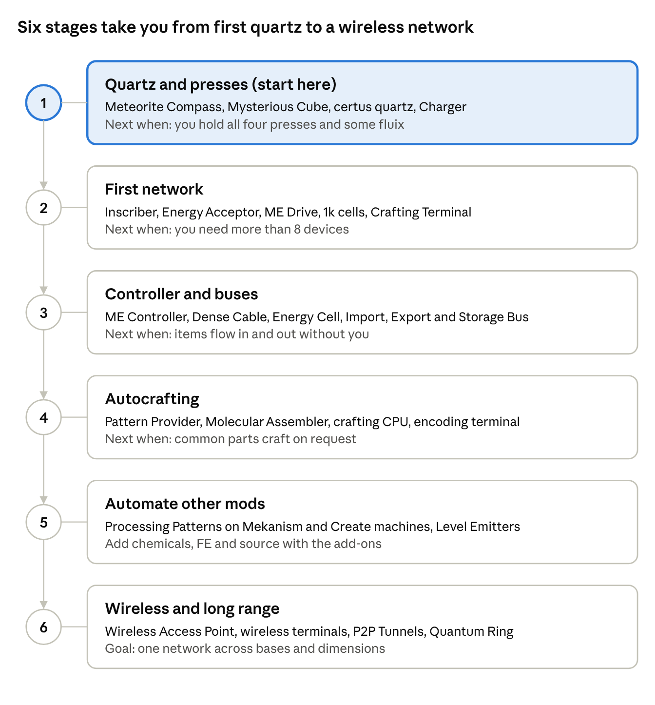

# Applied Energistics 2 Beginner's Guide

AE2 turns your storage into one searchable network and crafts items on demand. ByteNip runs AE2 19.2.18; block names and recipes below were checked against that jar.

Last updated Nov 12, 2026 · ByteNip 1.3.1

## The basics

AE2 has one job: every item you own lives on storage cells, and any terminal on the network can reach all of it. Everything else builds on that.

**Six concepts to learn first**

- **The in-game guide.** Hover any AE2 item and hold G to open its guide page, with 3D examples. It is the best reference for exact setups.
- **Energy.** Networks run on AE. An [Energy Acceptor](#power) converts FE from Mekanism or Create Crafts & Additions, so you rarely need AE2's own generators.
- **Channels.** Most devices (drives, terminals, buses) use one channel. Normal cable carries 8, [Dense Cable](#network-and-cables) carries 32. A network with no [ME Controller](#network-and-cables) can run 8 such devices in total.
- **Cells.** Storage is measured in bytes, and each cell holds at most 63 different item types. Many unique items fill a cell faster than stacks of one item.
- **Certus quartz.** Crystals grow on [Budding Certus Quartz](#materials-and-crafting-stations). Charged certus + redstone + nether quartz dropped in water makes 2 fluix crystals, the base of cables and most parts.
- **Processors.** Logic (gold), Calculation (certus) and Engineering (diamond) processors come from the [Inscriber](#materials-and-crafting-stations) and go into nearly every block.

## Progress map

Work down the stages in order. Stages 1 to 3 give you a full storage system; 4 onward is automation.

The stage numbers match the Stage column in the block tables below.

## Block breakdowns

Build roughly top to bottom in each table; the Stage column matches the progress map above. Block names elsewhere in this guide link back to these tables.

### Materials and crafting stations

| Block / item | What it does | Stage |
| --- | --- | --- |
| Meteorite Compass | Points to the nearest meteorite. | 1 |
| Mysterious Cube | Found at the centre of a meteorite; break it for all four Inscriber Presses. | 1 |
| Budding Certus Quartz | Grows certus buds on its faces. Flawless ones (in meteorites) never wear out but cannot be moved; Flawed, Chipped and Damaged ones can. | 1 |
| Charger | Charges Certus Quartz Crystals. Run it with a Wooden Crank or network power. | 1 |
| Inscriber | Presses printed circuits and silicon, then combines them with redstone into processors. | 2 |
| Growth Accelerator | Speeds up certus bud growth on the budding block it touches. | 3 |
| Sky Stone | Blast-resistant meteorite rock, used in several recipes. | 1 |

### Power

| Block | What it does | Stage |
| --- | --- | --- |
| Energy Acceptor | Turns FE from other mods into AE for the network. | 2 |
| Vibration Chamber | Burns furnace fuel to make AE. | 2 |
| Crystal Resonance Generator | Makes a small trickle of AE with no fuel. | 2 |
| Energy Cell | Stores AE so the network rides out demand spikes. | 3 |

### Storage

| Block / item | What it does | Stage |
| --- | --- | --- |
| ME Drive | Holds up to 10 storage cells. | 2 |
| ME Chest | Holds one cell and works as its own small terminal. | 2 |
| Storage Cells | Item and fluid cells from 1k to 256k. Each holds 63 different types, so bulk items waste less space than many unique ones. | 2 |
| Cell Workbench | Sets which items a cell accepts and adds cards to it. | 3 |
| ME IO Port | Moves contents between a cell and the network. | 5 |
| Matter Condenser | Destroys items and turns them into Matter Balls and Singularities. | 5 |

### Network and cables

| Block | What it does | Stage |
| --- | --- | --- |
| ME Glass, Covered and Smart Cable | Carry power and up to 8 channels. Smart cable shows how many are in use. | 2 |
| Dense Cable | Carries up to 32 channels. | 3 |
| ME Controller | The network's core. Without one, a network runs at most 8 channel-using devices; with one, each controller face supplies 32 channels. | 3 |
| ME Toggle Bus | Connects or cuts a section of network with redstone. | 5 |
| Quartz Fiber | Shares power between two networks without joining them. | 5 |

### Terminals

| Block | What it does | Stage |
| --- | --- | --- |
| ME Terminal | Search, take and deposit everything on the network. | 2 |
| ME Crafting Terminal | A terminal with a crafting grid that pulls ingredients from storage. | 2 |
| ME Pattern Encoding Terminal | Writes recipes onto Blank Patterns. | 4 |
| ME Pattern Access Terminal | Shows the patterns in every Pattern Provider from one place. | 4 |

### Buses and automation

| Block | What it does | Stage |
| --- | --- | --- |
| ME Import Bus | Pulls items or fluids from the block it faces into the network. | 3 |
| ME Export Bus | Pushes chosen items or fluids from the network into the block it faces. | 3 |
| ME Storage Bus | Makes the inventory it faces count as network storage: chests, drawers, tanks. | 3 |
| ME Interface | Keeps a set stock of items for other mods to take, and accepts whatever they push in. | 3 |
| ME Level Emitter | Emits redstone when a stored amount crosses a threshold. | 5 |
| ME Formation Plane | Places blocks or drops items from storage into the world. | 5 |
| ME Annihilation Plane | Breaks blocks or collects dropped items into storage. | 5 |

### Autocrafting

| Block / item | What it does | Stage |
| --- | --- | --- |
| Blank Pattern | Becomes a Crafting Pattern (crafting-table recipes) or a Processing Pattern (machine recipes). | 4 |
| ME Pattern Provider | Holds patterns and pushes their ingredients into the block it faces. | 4 |
| Molecular Assembler | Crafts Crafting Patterns when placed against a Pattern Provider. | 4 |
| Crafting Unit | Base block of a crafting CPU. A CPU is a solid box of these parts. | 4 |
| Crafting Storage | CPU part that sets how big a job it can plan (1k to 256k). | 4 |
| Crafting Co-Processing Unit | CPU part that lets one job run more steps at once. | 5 |
| Crafting Monitor | CPU part that shows what the CPU is making. | 4 |

### Wireless and long range

| Block / item | What it does | Stage |
| --- | --- | --- |
| ME Wireless Access Point | Gives wireless terminals a signal. Wireless Boosters extend its range. | 6 |
| Wireless Terminal and Wireless Crafting Terminal | Open the network from your inventory. | 6 |
| P2P Tunnels | Send channels, items, fluids, FE, redstone or light between two points over one channel. | 6 |
| ME Quantum Ring and Quantum Link Chamber | A paired bridge that joins two networks across any distance or dimension. | 6 |
| Spatial IO Port, Pylons and Storage Cells | Cut out a region of the world and store it in a cell. | 6 |

### Tools and cards

| Item | What it does | Stage |
| --- | --- | --- |
| Certus Quartz Wrench | Rotates and picks up AE2 parts. | 1 |
| Network Tool | Shows network stats and carries upgrade cards. | 3 |
| Memory Card | Copies settings between blocks and links P2P Tunnels. | 5 |
| Upgrade cards | Acceleration (speed), Capacity (more filter slots), Fuzzy, Inverter, Redstone and Crafting cards slot into buses, interfaces and cells. | 3 |
| Color Applicator | Recolours cables so neighbouring lines do not connect. | 5 |

## Getting started builds

Each build adds to the last, and nothing gets torn down. Tick steps off as you go.

**Build 1: Quartz and presses**

- [ ] Craft a [Meteorite Compass](#materials-and-crafting-stations) and follow it to a meteorite.
- [ ] Dig to the centre and break the [Mysterious Cube](#materials-and-crafting-stations) for the four Inscriber Presses. Take the sky stone and any certus too.
- [ ] Mine certus clusters from the [Budding Certus Quartz](#materials-and-crafting-stations) there. Leave the budding blocks in place so they keep growing, or use Fortune on full clusters.
- [ ] Craft a [Charger](#materials-and-crafting-stations) and a Wooden Crank, and charge some certus crystals.
- [ ] Drop charged certus, redstone and nether quartz into water to make fluix crystals.

**Build 2: First network**

- [ ] Build an [Inscriber](#materials-and-crafting-stations). Press printed circuits and printed silicon, then combine them with redstone into processors.
- [ ] Power: an [Energy Acceptor](#power) fed by a Mekanism Universal Cable.
- [ ] Place an [ME Drive](#storage) with two or three 1k [Storage Cells](#storage).
- [ ] Add an [ME Crafting Terminal](#terminals) and join everything with fluix cable.
- [ ] Empty your chests into the terminal. You now have searchable storage with no controller.

**Build 3: Controller and automation**

- [ ] Add an [ME Controller](#network-and-cables) and an [Energy Cell](#power). Run [Dense Cable](#network-and-cables) from the controller as a 32-channel trunk.
- [ ] Put an [ME Storage Bus](#buses-and-automation) on a Storage Drawers controller for cheap bulk storage.
- [ ] Put an [ME Import Bus](#buses-and-automation) on machine outputs and an [ME Export Bus](#buses-and-automation) on machine inputs.
- [ ] Speed buses up with Acceleration Cards from the [upgrade cards](#tools-and-cards).

**Build 4: Autocrafting**

- [ ] Build a crafting CPU: [Crafting Storage](#autocrafting) blocks joined into a solid box, even a single 1k block works.
- [ ] Place an [ME Pattern Provider](#autocrafting) against a [Molecular Assembler](#autocrafting).
- [ ] Add an [ME Pattern Encoding Terminal](#terminals). Encode a recipe onto a [Blank Pattern](#autocrafting) and put it in the provider.
- [ ] Request the item from any terminal. If an ingredient also has a pattern, AE2 crafts that first.

**Build 5: Craft through other mods' machines**

- [ ] Point a Pattern Provider at a Mekanism or Create machine and encode a Processing Pattern for its recipe.
- [ ] Return the output with an Import Bus, or set the machine to push into an [ME Interface](#buses-and-automation).
- [ ] Use an [ME Level Emitter](#buses-and-automation) with a Crafting Card on an Export Bus to keep a set stock of an item made.
- [ ] Add [Crafting Co-Processing Units](#autocrafting) so long jobs run steps in parallel.

Wireless, P2P and quantum links can wait. Most bases run for a long time on builds 1 to 4.

## AE2 in ByteNip

AE2 is the hub of the pack: nine installed mods extend it or plug into it. The full list of links is in [How mods interact](how-mods-interact.md).

| Mod (version) | What it adds to AE2 |
| --- | --- |
| Applied Mekanistics 1.6.3 | Mekanism chemicals in ME: 1k–256k chemical cells, Chemical P2P, buses and interfaces on chemical tanks. |
| MEGA Cells 4.11.0 | Cells from 1M to 256M for items, fluids and chemicals, bulk cells, a radioactive chemical cell, and larger crafting storage. |
| Applied Flux 2.1.5 | FE stored in cells. A Flux Accessor on a machine powers it straight from the network. |
| AE2 Wireless Terminals 19.5.1 | Wireless Pattern Encoding and Pattern Access terminals, plus a universal terminal that combines them. |
| Ars Énergistique 2.1.1 | Ars Nouveau source in ME: source cells, an ME Source Jar, Source and Spell P2P tunnels. |
| Create: Applied Kinetics 1.5.4 | Makes processors and Inscriber Presses by Create sequenced assembly, a second route besides the [Inscriber](#materials-and-crafting-stations). |
| Advanced Peripherals 0.8.2a | The ME Bridge lets a CC: Tweaked computer read storage and request crafts. |
| Storage Drawers, Sophisticated Storage | An [ME Storage Bus](#buses-and-automation) on their controller adds the whole wall of drawers or chests to the network. |
| Cable Facades + bytenip\_facades | AE2 facades also cover Mekanism cables and pipes, so mixed cable runs can hide in the same wall. |

**Recipes from other mods** (check JEI for the rest)

- **Mekanism:** the Crusher makes silicon from any sand and grinds certus, fluix, sky stone and ender pearls to dust. The Enrichment Chamber turns 1 certus dust into 2 silicon.
- **Create:** the Millstone grinds certus, fluix, sky stone and ender pearls, and the Mixer makes fluix crystals.
- **Create Crafts & Additions:** the Tesla Coil charges certus quartz like a [Charger](#materials-and-crafting-stations).
- **Controller players:** ByteNip's controller patch lets the right stick scroll AE2 terminals.

## Tips and common mistakes

- **"Device offline" usually means no channel.** Check a [Smart Cable](#network-and-cables): if it shows 8 of 8, that line is full. Add [Dense Cable](#network-and-cables) or another controller face.
- **One controller per network.** Two [ME Controllers](#network-and-cables) that are not touching shut the whole network down.
- **Do not break Flawless Budding Certus Quartz.** It drops nothing useful. Farm it where it stands, or make movable budding blocks by dropping a certus block and charged certus in water.
- **Mind the 63-type limit.** Keep tools, enchanted books and other unique items on their own cell, and bulk items in drawers behind an [ME Storage Bus](#buses-and-automation).
- **Partition cells.** Use the [Cell Workbench](#storage) to reserve a cell for one item, so cobblestone cannot flood everything.
- **A crafting CPU must be a solid box.** Any gap or odd shape stops it forming.
- **Crafting stuck?** Open the [Crafting Monitor](#autocrafting) or the terminal's crafting status to see which step is waiting, usually a machine that is full or unpowered.
- **Feed it enough power.** A growing network draws more AE. Add an [Energy Cell](#power) before it starts browning out.
