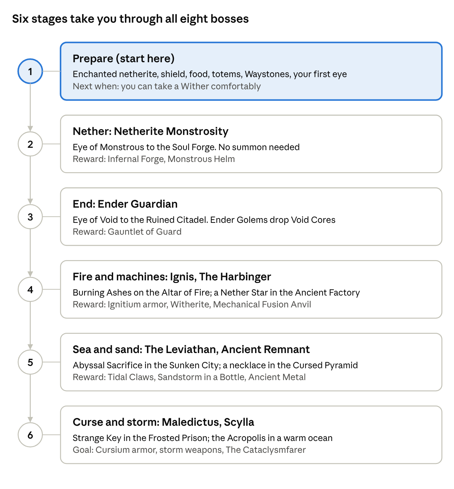

# L\_Ender's Cataclysm Beginner's Guide

Cataclysm adds eight boss fights, each at the heart of its own large structure, and the strongest weapons and armor in the pack as rewards. ByteNip runs Cataclysm 3.33; structures, recipes and drops below were read from that jar.

Last updated Nov 12, 2026 · ByteNip 1.3.1

## The basics

Every boss follows the same loop: craft its eye, follow the eye to its structure, clear the way in, start the fight, and turn the drops into gear for the next one.

**Six things to know first**

- **Eyes.** Each boss has an eye crafted around an Eye of Ender. Throw it like one and it flies toward [that boss's structure](#bosses-and-where-to-find-them). JEI shows each recipe.
- **Structures need the right biome.** Each one generates only in the biomes in the table, and only in chunks created after the mod was added. Terralith adds many new biomes, so the plain vanilla ones can be a long trip away.
- **Three dimensions.** Two bosses are in the Nether, one is in the End, and five are in the Overworld. The Eye of Void needs shulker shells, so the End boss comes after your first End city.
- **Mini-bosses hold the keys.** Several fights cannot start until a [mini-boss](#mini-bosses-and-mobs) in the same structure drops the item that [starts them](#starting-each-fight).
- **Drops are the reward.** Bosses drop finished weapons or a rare ingot, and the [Mechanical Fusion Anvil](#blocks) combines two of them into something stronger.
- **Come prepared.** These fights expect enchanted netherite, a shield, good food and a way back to your grave. They are the hardest content in the pack.

## Progress map

The order is a suggestion, from fights you can walk into to fights that need a mini-boss item first. The mod does not force any order.

The stage numbers match the Stage column in the tables below.

## Boss and item breakdowns

The Stage column matches the progress map above. Boss, block and item names elsewhere in this guide link back to these tables.

### Bosses and where to find them

| Boss | Structure | Biome | Eye that finds it | Stage |
| --- | --- | --- | --- | --- |
| Netherite Monstrosity | Soul Forge | Nether: wastes, crimson and warped forest, soul sand valley | Eye of Monstrous | 2 |
| Ender Guardian | Ruined Citadel | End highlands and midlands | Eye of Void | 3 |
| Ignis | Burning Arena | Nether wastes | Eye of Flame | 4 |
| The Harbinger | Ancient Factory | Underground in the Overworld | Eye of Mech | 4 |
| The Leviathan | Sunken City | Deep oceans | Eye of Abyss | 5 |
| Ancient Remnant | Cursed Pyramid | Desert | Eye of Desert | 5 |
| Maledictus | Frosted Prison | Snowy plains | Eye of Curse | 6 |
| Scylla | Acropolis | Warm ocean | Eye of Storm | 6 |

### Starting each fight

| Boss | How the fight starts | What you need first |
| --- | --- | --- |
| Netherite Monstrosity | It waits in the Soul Forge and attacks when you get close. | Nothing. |
| Ender Guardian | It waits in the Ruined Citadel and attacks when you get close. | Nothing. Ender Golems guard the way in. |
| Ignis | Summoned: use Burning Ashes on the Altar of Fire. | Burning Ashes, dropped by Ignited Revenants in the arena or crafted from Dying Embers. |
| The Harbinger | Woken: it sits switched off in the factory until you use a Nether Star on it. | A Nether Star (kill a Wither). |
| The Leviathan | Summoned: use an Abyssal Sacrifice on the Altar of Abyss. | An Abyssal Sacrifice, crafted from an Athame, a Heart of the Sea, coral from Coralssus and other items. |
| Ancient Remnant | Woken: brush the suspicious sand in the pyramid for the Necklace of the desert, then use it on the remains. | A brush. |
| Maledictus | Summoned at the Cursed Tombstone behind the Door of Seal. | A Strange Key, dropped by the Aptrgangr. |
| Scylla | She waits at the Acropolis. | Nothing. Clawdians guard the way in. |

### Boss drops

| Boss | Drops | What they make |
| --- | --- | --- |
| Netherite Monstrosity | Infernal Forge, Monstrous Horn, Lava Power Cell | The Infernal Forge is a pickaxe with an area slam. The horn makes the Monstrous Helm. |
| Ender Guardian | Gauntlet of Guard | Pulls enemies toward you. |
| Ignis | Ignitium Ingot | Ignitium armor, The Incinerator, Bulwark of the Flame, Blazing Grips. |
| The Harbinger | Block of Witherite | Witherite for the Mechanical Fusion Anvil, Wither Assault Shoulder Weapon, Meat Shredder and Laser Gatling. |
| The Leviathan | Tidal Claws, Abyssal Egg | Tidal Claws are a grappling hook and ranged attack. |
| Ancient Remnant | Block of Ancient Metal, Sandstorm in a Bottle, Remnant Skull | Ancient metal makes the Ancient Spear and Bone Reptile armor. The skull summons a tameable Modern Remnant. |
| Maledictus | Cursium Ingot | Cursium armor, Soul Render, The Annihilator, Cursed Bow. All of them also need Black Steel from the Aptrgangr. |
| Scylla | Essence of the Storm, Lacrima | Storm weapons: Ceraunus and Astrape. |

### Mini-bosses and mobs

| Mob | Where | Drops | Stage |
| --- | --- | --- | --- |
| Ender Golem | Ruined Citadel | Void Core | 3 |
| Ignited Revenant | Burning Arena | Burning Ashes | 4 |
| The Prowler and The Watcher | Ancient Factory | Guards of the factory | 4 |
| Coralssus and Deeplings | Sunken City and deep oceans | Coral Chunk | 5 |
| Kobolediator and Koboletons | Cursed Pyramid and deserts | Ancient Metal Ingot, Koboleton Bone | 5 |
| Aptrgangr and Draugr | Frosted Prison | Black Steel, Strange Key | 6 |
| Clawdian | Acropolis | Chitin Claw, Lacrima | 6 |
| Amethyst Crab | Amethyst Nest in lush caves | Amethyst Crab Shell and Meat | 1 |

### Blocks

| Block | What it does |
| --- | --- |
| Altar of Fire | In the Burning Arena. Burning Ashes on it summon Ignis. |
| Altar of Abyss | In the Sunken City. An Abyssal Sacrifice on it summons The Leviathan. |
| Altar of Void | In the Ruined Citadel. |
| Altar of Amethyst | Blesses Amethyst Crab Meat. Blessed meat makes you immune to darkness, abyssal fear and abyssal burn. |
| Cursed Tombstone | In the Frosted Prison. Summons Maledictus. If it says its power is still weak, the conditions are not met yet. |
| Door of Seal | Blocks the way to the tombstone. Opens with a Strange Key. |
| Mechanical Fusion Anvil | Fuses two boss items into a stronger weapon, such as Infernal Forge + Void Core into the Void Forge. Crafted with Witherite, so it comes after The Harbinger. |
| Boss Respawner | Lets you fight a defeated boss again; check JEI for how to arm it. |

### Weapons

| Weapon | What it does |
| --- | --- |
| The Incinerator | Hold right-click 3 seconds to charge, release for a flame strike. The strike can destroy dropped items. |
| Bulwark of the Flame | Shield. Release while sneaking to charge forward. |
| Gauntlet of Guard | Right-click pulls enemies in. |
| Tidal Claws | Right-click fires a grappling hook; left-click shoots a tentacle. |
| Infernal Forge and Void Forge | Pickaxes. Right-click a block for an area attack. |
| Soul Render | Halberd with a rush attack; sneaking summons Phantom Halberds. |
| The Annihilator | High critical damage; two-handed charge for an area hit. |
| Cursed Bow | Shoots 3 Phantom Arrows. |
| Ceraunus | Throwable anchor; sneaking summons waves. |
| Astrape | Right-click shoots a Lightning Spear. |
| Wrath of the Desert | Fires three cursed sandstorms. Fused from the Cursed Bow and Sandstorm in a Bottle. |
| Zweiender | Deals 200% damage from behind. |
| Final Fractal | Adds 3% of the target's maximum health as damage. |
| Wither Assault Shoulder Weapon | Shoots Wither Missiles; sneaking shoots Wither Howitzers. |
| Meat Shredder | Right-click damages in front and ignores invulnerability frames. |
| Laser Gatling | Rapid laser; reloads from redstone in your inventory. |

### Armor and trinkets

| Item | What it does |
| --- | --- |
| Ignitium armor | Upgrade netherite armor at a Smithing Table with the Ignitium Upgrade template and Ignitium Ingots. Helmet brands a target, leggings reflect flame, boots walk on lava, and the chestplate can merge with an elytra. |
| Cursium armor | Upgrade netherite armor at a Smithing Table with the Cursium Upgrade template and Cursium Ingots. The chestplate revives you at 5 health once every 6 minutes; leggings sometimes dodge attacks. |
| Monstrous Helm | Below half health it knocks back nearby enemies; adds defense and regeneration. |
| Bone Reptile armor | Helmet and chestplate from Ancient Metal and Koboleton Bones. |
| Bloom Stone Pauldrons | Fire amethyst clusters around you on a key press. |
| Sandstorm in a Bottle | Right-click summons 2 orbiting sandstorms. |
| Sturdy Boots | Walk on powder snow. |
| Remnant Skull and Netherite Effigy | Summon a tameable Modern Remnant or Netherite Ministrosity. |

## Fight plans

The order below is a suggestion that goes from the simplest starts to the most involved. Any order works if your gear is good enough. Tick steps off as you go.

**Plan 1: Prepare**

- [ ] Get full netherite armor with Protection, a strong sword or axe, a bow and a shield.
- [ ] Stock cooked Farmer's Delight meals, golden apples and a few Totems of Undying.
- [ ] Set a Waystone near your base and carry the materials for another, so each structure becomes a short trip.
- [ ] Craft the eye for your first boss and mark the structure with a Xaero waypoint when you find it.

**Plan 2: Netherite Monstrosity**

- [ ] Throw an Eye of Monstrous in the Nether and follow it to the Soul Forge.
- [ ] Bring Fire Resistance potions; the forge is full of lava.
- [ ] Approach the [Netherite Monstrosity](#bosses-and-where-to-find-them) to start the fight.
- [ ] Collect the [Infernal Forge and Monstrous Horn](#boss-drops), and make the [Monstrous Helm](#armor-and-trinkets) at a Smithing Table.

**Plan 3: Ender Guardian**

- [ ] Throw an Eye of Void in the outer End and follow it to the Ruined Citadel.
- [ ] Kill the [Ender Golems](#mini-bosses-and-mobs) on the way for Void Cores.
- [ ] Fight the [Ender Guardian](#bosses-and-where-to-find-them) for the [Gauntlet of Guard](#weapons).

**Plan 4: Ignis**

- [ ] Throw an Eye of Flame in the Nether and follow it to the Burning Arena.
- [ ] Kill [Ignited Revenants](#mini-bosses-and-mobs) for Burning Ashes.
- [ ] Use the ashes on the [Altar of Fire](#blocks) to summon Ignis.
- [ ] Spend the Ignitium Ingots on [Ignitium armor](#armor-and-trinkets) or [The Incinerator](#weapons). After this fight, Ignited Berserkers start appearing in Nether fortresses.

**Plan 5: The Harbinger**

- [ ] Kill a Wither for a Nether Star.
- [ ] Throw an Eye of Mech and dig down to the Ancient Factory.
- [ ] Clear The Prowlers and Watchers, then use the Nether Star on the dormant [Harbinger](#starting-each-fight).
- [ ] Craft a [Mechanical Fusion Anvil](#blocks) from the Witherite.

**Plan 6: The Leviathan**

- [ ] Brew Water Breathing, or use Mekanism Scuba gear; the whole fight is underwater.
- [ ] Throw an Eye of Abyss over deep ocean and dive to the Sunken City.
- [ ] Kill a [Coralssus](#mini-bosses-and-mobs) for coral and craft an Abyssal Sacrifice.
- [ ] Use it on the [Altar of Abyss](#blocks). The Leviathan cannot be hurt while it is out of the water.
- [ ] After this fight, Coral Golems start appearing in oceans.

**Plan 7: Ancient Remnant**

- [ ] Throw an Eye of Desert and follow it to the Cursed Pyramid. Watch for sandstone traps.
- [ ] Brush the suspicious sand inside until you find the Necklace of the desert.
- [ ] Use the necklace on the remains to wake the [Ancient Remnant](#starting-each-fight).

**Plan 8: Maledictus**

- [ ] Throw an Eye of Curse and follow it to the Frosted Prison in snowy plains.
- [ ] Kill the [Aptrgangr](#mini-bosses-and-mobs) for the Strange Key and Black Steel.
- [ ] Open the [Door of Seal](#blocks) and use the [Cursed Tombstone](#blocks) to summon Maledictus.
- [ ] Turn the Cursium into [Cursium armor](#armor-and-trinkets), which revives you once on death.

**Plan 9: Scylla**

- [ ] Throw an Eye of Storm over warm ocean and follow it to the Acropolis.
- [ ] Fight through the [Clawdians](#mini-bosses-and-mobs) to reach Scylla.
- [ ] Craft [Ceraunus or Astrape](#weapons) from the Essence of the Storm.

Defeating all eight earns the advancement The Cataclysmfarer.

## Cataclysm in ByteNip

Two installed add-ons turn boss drops into magic gear, and several other pack mods make the trips and fights easier. All links between mods are in [How mods interact](how-mods-interact.md).

| Mod (version) | What it does with Cataclysm |
| --- | --- |
| Cataclysm: Spellbooks 1.1.15 | Turns boss drops into Iron's Spells spellbooks, armor and spells themed on each boss. |
| Goety Cataclysm 1.8.4 | Adds Goety spells, servants and gear based on Cataclysm bosses and materials. |
| Goety 3.2.2 | Brews two Cataclysm effects, Blazing Brand and Curse of Desert. |
| Curios | Holds Cataclysm's trinkets in accessory slots. |
| Xaero's Minimap and World Map | Waypoint each structure when the eye leads you to it. |
| Waystones | Place one outside a structure so a death is not a second long trip. |
| GraveStone | Keeps your items in a grave where you died, so a failed attempt does not cost your gear. |
| Apotheosis | Affixed and socketed gear gives you more damage and defense going in. |
| Mekanism | Scuba gear for [The Leviathan](#bosses-and-where-to-find-them); a Jetpack or MekaSuit as late-game alternatives. |
| Farmer's Delight | Meals with long buffs for boss attempts. |

## Tips and common mistakes

- **An eye that will not fly has nothing to find.** Check you are in the right dimension. Structures also only exist in chunks generated after the mod was added, so explore new land.
- **Look for the right biome.** The [Cursed Pyramid](#bosses-and-where-to-find-them) needs a plain desert, the Frosted Prison snowy plains, the Acropolis a warm ocean. Terralith's look-alike biomes do not count.
- **Do not skip the mini-boss.** No Burning Ashes, Strange Key or coral means no fight. See [Starting each fight](#starting-each-fight).
- **The tombstone says its power is still weak?** The summon conditions are not met yet. Try again at a different time of day.
- **The Leviathan is invincible out of water.** Keep the fight submerged and bring Water Breathing.
- **Careful with The Incinerator.** Its flame strike can destroy items on the ground, including boss drops.
- **Set a way back first.** Place a Waystone near the structure (beds explode in the Nether and the End) before you start, so a death is a short walk to your grave.
- **Fuse, do not hoard.** A spare boss weapon is half of a [Mechanical Fusion Anvil](#blocks) recipe; check JEI before storing it away.
