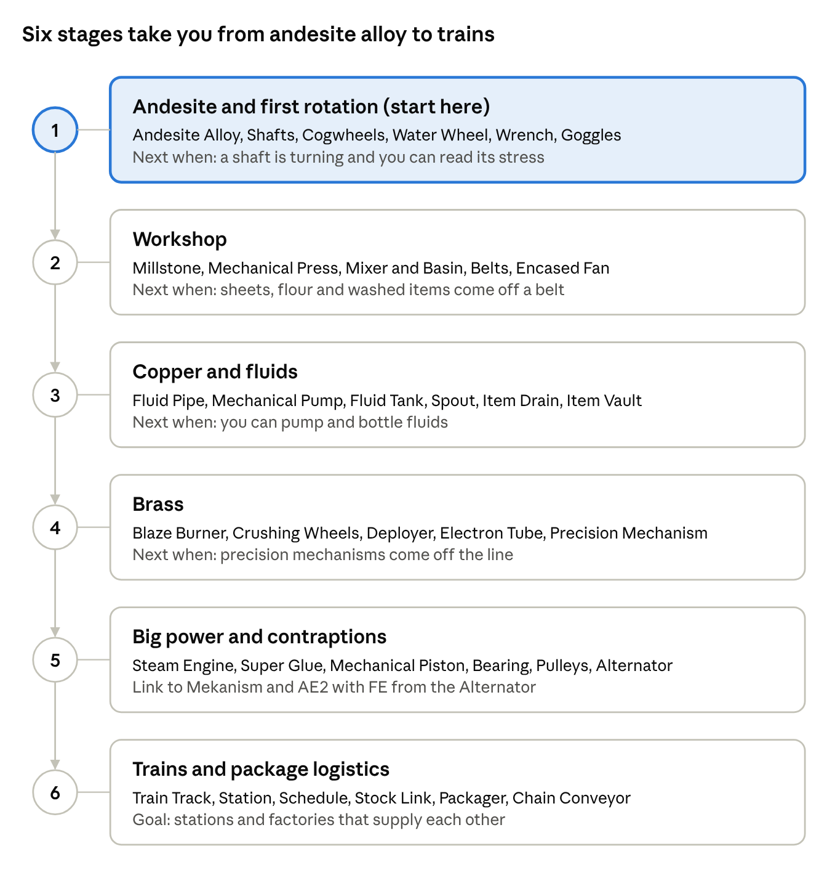

# Create Beginner's Guide

Create builds machines out of moving parts: shafts, cogs and belts you can watch work. ByteNip runs Create 6.0.10; block names and recipes below were checked against that jar.

Last updated Nov 12, 2026 · ByteNip 1.3.1

## The basics

Create has no power cables and no machine GUIs. A source turns a shaft, the shaft turns a machine, and you can see every step.

**Six concepts to learn first**

- **Ponder.** Hover any Create item in your inventory or JEI and hold W for an animated lesson on how it works. Use it constantly.
- **Rotation and stress.** Every source adds stress capacity and every machine uses some. If use exceeds capacity the whole network stops, so add sources before machines. [Engineer's Goggles](#materials-and-tools) show both numbers.
- **Speed.** Measured in RPM, up to 256. Faster machines work quicker but use more stress. Change speed with [cogwheel](#moving-rotation) ratios.
- **Tiers by material.** Andesite parts come first, then copper for fluids, then brass for smart parts. Each tier has its own casing.
- **Heat.** Some Mixer recipes need a [Blaze Burner](#processing) under the Basin. Brass is the first one.
- **No FE.** Create machines never take electricity. Create Crafts & Additions converts rotation to FE and back.

## Progress map

Work down the stages in order. Stages 1 and 2 need only andesite and iron; brass at stage 4 is where the mod opens up.

The stage numbers match the Stage column in the block tables below.

## Block breakdowns

Build roughly top to bottom in each table; the Stage column matches the progress map above. Block names elsewhere in this guide link back to these tables.

### Materials and tools

| Item | What it does | Stage |
| --- | --- | --- |
| Andesite Alloy | Base material for the first tier: andesite + iron nuggets. | 1 |
| Andesite Casing | Right-click a stripped log with Andesite Alloy. Shell for early machines. | 1 |
| Wrench | Rotates parts; sneak-right-click picks them up instantly. | 1 |
| Engineer's Goggles | Show speed, stress and what a machine is doing when you look at it. | 1 |
| Copper Casing | Shell for fluid parts. | 3 |
| Brass Ingot and Brass Casing | Copper + zinc in a heated Mixer makes brass, the second tier. | 4 |
| Electron Tube | Polished Rose Quartz on an Iron Sheet. Goes into smart brass parts. | 4 |
| Precision Mechanism | Made by sequenced assembly from a Golden Sheet. Gate to the advanced machines. | 4 |
| Sturdy Sheet and Train Casing | Powdered obsidian, lava and pressing make Sturdy Sheets; apply one to Brass Casing for Train Casing. | 6 |

### Power sources

| Block | What it does | Stage |
| --- | --- | --- |
| Hand Crank | Turn it by hand. Enough to test a machine. | 1 |
| Water Wheel | Steady early power from flowing water. | 1 |
| Large Water Wheel | More stress capacity at a slower speed. | 2 |
| Windmill Bearing | Spins a structure of Windmill Sails; more sails, more power. | 2 |
| Steam Engine | Mounts on a Fluid Tank boiler heated by Blaze Burners. The strongest source. | 5 |

### Moving rotation

| Block | What it does | Stage |
| --- | --- | --- |
| Shaft | Carries rotation in a straight line. | 1 |
| Cogwheel and Large Cogwheel | Pass rotation sideways. Small driving large halves speed; large driving small doubles it. | 1 |
| Gearbox | Turns rotation around a corner. | 1 |
| Encased Chain Drive | Passes rotation along a row of blocks. | 2 |
| Clutch and Gearshift | Stop or reverse rotation with redstone. | 2 |
| Speedometer and Stressometer | Show the speed and stress load of a network. | 2 |
| Rotation Speed Controller | Sets an exact speed. | 4 |
| Sequenced Gearshift | Runs timed sequences of turns, for precise contraptions. | 4 |

### Processing

| Block | What it does | Stage |
| --- | --- | --- |
| Millstone | Grinds single items: wheat to flour, flowers to dye, gravel to flint. It does not crush ores. | 2 |
| Mechanical Press | Presses ingots into sheets; packs items on a Basin. | 2 |
| Mechanical Mixer and Basin | Mixes shapeless recipes and alloys. | 2 |
| Encased Fan | Bulk-processes items in its air stream: washing through water, smelting through lava, smoking through fire. | 2 |
| Mechanical Saw | Cuts logs and stone; fells trees on a contraption. | 2 |
| Mechanical Drill | Breaks the block in front of it. | 2 |
| Blaze Burner | Heats the Basin or boiler above it. Fuel gives heat; a Blaze Cake gives super-heat. | 4 |
| Crushing Wheels | A pair that crushes anything dropped between them, with by-products. | 4 |
| Deployer | Uses an item like a player would: places, clicks, applies. | 4 |
| Mechanical Crafter | Joins into grids for large shaped recipes. | 4 |
| Spout | Fills items and bottles from a fluid above a belt or Depot. | 3 |
| Item Drain | Empties fluid out of items passing over it. | 3 |

### Moving items

| Block | What it does | Stage |
| --- | --- | --- |
| Mechanical Belt | Conveyor between two shafts. Machines work on items as they pass. | 2 |
| Depot | A single-item stand for presses, spouts and deployers. | 2 |
| Chute | Drops items straight down. | 2 |
| Andesite Funnel | Moves items between a belt and an inventory. | 2 |
| Brass Funnel and Brass Tunnel | Filtered funnel; tunnels split and sort belts. | 4 |
| Mechanical Arm | Picks from and places into several inventories in range. | 4 |
| Item Vault | Large multiblock storage that works on contraptions. | 3 |
| Stock Link, Stock Ticker and Packager | Package logistics: request items from linked storage and have them boxed. | 6 |
| Chain Conveyor and Package Frogport | Carry packages long distances and drop them at named stops. | 6 |
| Factory Gauge | Keeps a set stock of an item and orders the recipe when it runs low. | 6 |

### Fluids

| Block | What it does | Stage |
| --- | --- | --- |
| Fluid Pipe | Carries fluids. Needs a pump. | 3 |
| Mechanical Pump | Pushes fluid through pipes in the direction of its arrow. | 3 |
| Fluid Tank | Multiblock fluid storage; also the boiler for Steam Engines. | 3 |
| Hose Pulley | Drains or fills a body of fluid in the world. | 3 |

### Contraptions

| Block / item | What it does | Stage |
| --- | --- | --- |
| Super Glue | Sticks blocks together so they move as one. | 5 |
| Mechanical Piston | Pushes a glued structure in a line. | 5 |
| Mechanical Bearing | Rotates a glued structure. | 5 |
| Rope Pulley and Elevator Pulley | Raise and lower structures; the elevator one stops at floors. | 5 |
| Gantry Carriage | Slides a structure along a Gantry Shaft. | 5 |
| Mechanical Harvester, Plough and Roller | Farm, clear or pave from a moving contraption. | 5 |
| Portable Storage Interface | Passes items to and from a contraption when it stops next to one. | 5 |

### Trains

| Block / item | What it does | Stage |
| --- | --- | --- |
| Train Track | Rails for trains; curves and slopes place automatically. | 6 |
| Train Station | Assembles a train from blocks on Train Casing and is its stop. | 6 |
| Train Controls | The driver's seat for a train. | 6 |
| Train Signal and Train Observer | Stop trains from colliding and detect passing trains. | 6 |
| Train Schedule | A list of stops and conditions that makes a train run by itself. | 6 |

## Getting started builds

Each build adds to the last. Tick steps off as you go.

**Build 1: First rotation**

- [ ] Craft [Andesite Alloy](#materials-and-tools) from andesite and iron nuggets.
- [ ] Craft [Shafts](#moving-rotation) and [Cogwheels](#moving-rotation), and make [Andesite Casing](#materials-and-tools) by right-clicking stripped logs with alloy.
- [ ] Place a [Water Wheel](#power-sources) with water flowing past it and run a shaft out of its centre.
- [ ] Craft a [Wrench](#materials-and-tools) and [Engineer's Goggles](#materials-and-tools), then look at the wheel to read its stress capacity.

**Build 2: Workshop**

- [ ] Add a [Millstone](#processing) for flour, dyes and flint.
- [ ] Add a [Mechanical Press](#processing) over a [Depot](#moving-items) to make iron, copper and golden sheets.
- [ ] Add a [Mechanical Mixer](#processing) over a Basin.
- [ ] Join the stations with a [Mechanical Belt](#moving-items) and [Andesite Funnels](#moving-items).
- [ ] Running short of stress? Add more water wheels or a [Windmill Bearing](#power-sources).

**Build 3: Washing line**

- [ ] Point an [Encased Fan](#processing) through a water block along a belt. Items in the wet air stream get washed.
- [ ] Wash gravel for flint and iron nuggets, or red sand for gold nuggets. Once you have Crushing Wheels (Build 4), wash crushed raw ore here: each piece gives 9 nuggets plus a chance of a by-product.
- [ ] Swap the water for lava to bulk-smelt, or a campfire to bulk-smoke food.
- [ ] For more ingots per ore, send raw ore to Mekanism instead; Create's strength here is the by-products.

**Build 4: Brass**

- [ ] Mine zinc, and catch a blaze in an Empty Blaze Burner to get a [Blaze Burner](#processing).
- [ ] Put the burner under the Basin and feed it fuel. Mix copper and zinc ingots into [brass](#materials-and-tools).
- [ ] Craft Rose Quartz, polish it with Sand Paper, and make [Electron Tubes](#materials-and-tools).
- [ ] Build [Crushing Wheels](#processing) to crush ores, and a [Deployer](#processing).
- [ ] Set up sequenced assembly for [Precision Mechanisms](#materials-and-tools): a Golden Sheet on a belt passing Deployers that add a cogwheel, a large cogwheel and an iron nugget, five times round.

**Build 5: Big power and the rest of the pack**

- [ ] Build a [Steam Engine](#power-sources) on a [Fluid Tank](#fluids) boiler with Blaze Burners below and a [Mechanical Pump](#fluids) feeding water.
- [ ] Attach a Create Crafts & Additions Alternator to a fast shaft to make FE for Mekanism and AE2.
- [ ] Glue a row of [Mechanical Drills](#processing) to a [Mechanical Piston](#contraptions) or minecart contraption for a tunnel bore.
- [ ] Ready for more? Lay [Train Track](#trains) and build a [Train Station](#trains).

Trains and package logistics are optional. Builds 1 to 4 unlock almost every machine.

## Create in ByteNip

ByteNip has eleven Create add-ons and bridges installed. The full list of links between mods is in [How mods interact](how-mods-interact.md).

| Mod (version) | What it adds to Create |
| --- | --- |
| Create Crafts & Additions 1.6.0 | Alternator (rotation to FE), Electric Motor (FE to rotation), Rolling Mill for rods and wires, Tesla Coil, Accumulator. |
| Steam 'n' Rails 0.2.1 | More track types, bogeys, signals and train parts. |
| Create: Enchantment Industry 2.4.2 | Liquid experience, automated enchanting and disenchanting. |
| Create Slice & Dice 4.3.4 | A Slicer that automates Farmer's Delight Cutting Board recipes, and Cooking Pots that take pipes. |
| Create: Bells & Whistles 0.4.7 | Train decoration and small utility blocks. |
| Create: Dragons Plus 1.11.9 | Extra fan processing types and fluids; also a library for other add-ons. |
| Create Deco 2.1.3 | Industrial bricks, catwalks, cage lamps and doors. |
| Create: Applied Kinetics 1.5.4 | AE2 processors and Inscriber Presses by sequenced assembly. |
| Ars Creo 5.4.0 | The Starbuncle Wheel, a rotation source run by an Ars Nouveau starbuncle. |
| Sophisticated Storage Create Integration | Sophisticated chests and barrels keep working on moving contraptions. |
| CC: Tweaked | Several Create blocks, including train stations and the Speedometer, work as computer peripherals. |

**Recipes shared with other mods** (check JEI for the rest)

- **Mekanism:** [Crushing Wheels](#processing) and washing handle osmium, tin, lead and uranium. Mekanism's Metallurgic Infuser makes Rose Quartz and its Enrichment Chamber polishes it.
- **AE2:** the [Millstone](#processing) grinds certus, fluix, sky stone and ender pearls, and the [Mixer](#processing) makes fluix crystals.
- **Farmer's Delight:** milling and [Spout](#processing) filling recipes for its foods.
- **Iron's Spells:** the Spout and [Item Drain](#processing) fill and empty its ink bottles and potion vials.
- **Ars Nouveau and Malum:** the [Mechanical Saw](#processing) cuts archwood, and Crushing Wheels process Malum's impetus items.

## Tips and common mistakes

- **Everything stopped? You are overstressed.** Put on the [goggles](#materials-and-tools) and look at any part. Add a source or slow the network down.
- **Speed costs stress.** Doubling a machine's RPM doubles the stress it uses. Gear up only the machines that need it.
- **Two sources fighting break shafts.** Sources on one network must turn the same way at the same speed. Use the [Wrench](#materials-and-tools) to flip one.
- **Water wheels need moving water.** A still pool does nothing; let the water flow past the paddles.
- **Feed the Blaze Burner.** It only heats while it has fuel. A [Mechanical Arm](#moving-items) or Deployer can keep it stocked.
- **Glue before you move.** Blocks on a contraption only travel together if [Super Glue](#contraptions) joins them.
- **Chunk-load long builds.** Belts and trains stop at unloaded chunks. Claim the chunks with Open Parties and Claims if the server force-loads claims, or keep them near your base.
- **Use Ponder before asking.** Holding W on a part answers most "how do I place this" questions faster than a wiki.
