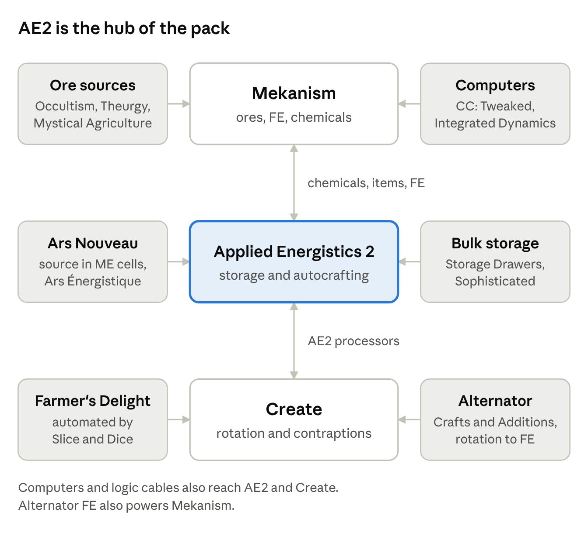

# How mods interact

AE2 is the hub of the pack: it stores Mekanism chemicals, Ars Nouveau source and FE, and its processors can be built by Create. Every link below was found in the mod files in ByteNip 1.3.1.

## At a glance

Mekanism and Create each trade with AE2 in the middle; the six outer boxes feed one of the three. The tables below list every link.

## Tech links

Power, storage and ores are the three things the tech mods share. FE is the common power unit; only Create needs a converter.

| Link | What crosses | How |
| --- | --- | --- |
| Create → Mekanism, AE2, Cyclic | Power | Create Crafts & Additions Alternator turns rotation into FE; the Electric Motor goes the other way. |
| Mekanism → AE2 | Power | Universal Cable into an AE2 Energy Acceptor. |
| AE2 → any FE machine | Power | Applied Flux stores FE in cells; a Flux Accessor hands it to machines. |
| Mekanism ↔ AE2 | Chemicals | Applied Mekanistics cells (1k–256k), MEGA Cells (1M–256M, plus the radioactive cell), Chemical P2P. |
| Mekanism ↔ AE2 | Items | Storage bus on a QIO Dashboard; Pattern Providers on machines for autocrafting. |
| Create → AE2 | Processors | Create: Applied Kinetics builds AE2 processors and presses by sequenced assembly. |
| Create, Mekanism → AE2 | Materials | Millstone and Crusher both grind certus, fluix, sky stone and ender pearls; the Crusher makes silicon from sand. |
| Create ↔ Mekanism | Ores | Crushing wheels and washing process osmium, tin, lead and uranium. Mekanism's chain yields more. |
| Mekanism → Create | Quartz | The Metallurgic Infuser turns quartz + redstone into rose quartz, and the Enrichment Chamber polishes it. |
| Create Crafts & Additions → AE2 | Quartz | The Tesla Coil charges certus quartz. |
| Drawers, Sophisticated Storage → AE2 | Items | Storage bus on a Drawer Controller or Storage Controller. |
| Mystical Agriculture → Mekanism, Create, Integrated Dynamics | Resources | Seeds for Mekanism metals, Create stones and Menril. |
| Integrated Dynamics ↔ Mekanism, AE2, Create | Items, fluids, FE, readings | Integrated Tunnels on any side of a machine. |
| CC: Tweaked → AE2, Mekanism | Monitoring and control | Advanced Peripherals ME Bridge; Mekanism blocks as peripherals. |
| Cable Facades → Mekanism | Looks | AE2 facades cover Mekanism cables, pipes and tubes. |

## Magic and adventure links

The magic mods mostly stand alone; the links are add-ons built for a pair of mods, plus a few shared recipes.

| Link | What crosses | How |
| --- | --- | --- |
| Ars Nouveau → AE2 | Source | Ars Énergistique: source cells (1k–256k), ME Source Jar, Source and Spell P2P tunnels. |
| Ars Nouveau → Create | Rotation | Ars Creo's Starbuncle Wheel. Create's saw also cuts archwood. |
| L\_Ender's Cataclysm → Iron's Spells | Spells and gear | Cataclysm: Spellbooks turns boss drops into spellbooks, armor and spells. |
| Add-ons → Iron's Spells | Spells, companions | Apprentice's Codex, Discerning the Eldritch, Alshanex's Familiars. |
| Create → Iron's Spells | Ink and potions | Create fills and empties its ink bottles and vials. |
| L\_Ender's Cataclysm → Goety | Spells, servants, brews | Goety Cataclysm, plus Goety brews for Cataclysm effects. |
| Goety → Iron's Spells, Cyclic | Brews, enchantments | Goety brews some Iron's Spells effects and can apply Cyclic enchantments. |
| Goety, Ars Nouveau → Malum | Spirits | Scythe kills on those mods' mobs drop Malum spirits. |
| Malum ↔ Occultism, Create, Farmer's Delight | Repairs and processing | Repairs Occultism chalk; Create crushes its impetus; the Cutting Board strips its logs. |
| Occultism → Mekanism | Ores | Crusher spirits grind Mekanism ores and clumps; miner spirits return osmium, tin, lead, uranium and fluorite. |
| Theurgy → Mekanism | Ores | Liquefaction recipes for osmium, tin, lead and uranium. |
| Apotheosis ↔ Goety, Occultism | Affixes, shelves | Affixes roll on the Dark Wand; Occultism candles and crystals count as enchanting shelves. |
| Create: Enchantment Industry → Apotheosis | Enchanting | Automated enchanting and liquid XP alongside the Apothic enchanting table. |
| Create, Mekanism → Farmer's Delight | Food processing | Create Slice & Dice automates cutting and cooking; the Precision Sawmill cuts meat. |
| Curios → most gear mods | Accessory slots | Spellbooks, rings, charms and backpacks share its slots. |

## Things that do not connect

Four gaps are worth knowing before you plan a build.

- **Create has no FE of its own.** Rotation only becomes FE through a Create Crafts & Additions Alternator, and the conversion loses some power.
- **Mekanism chemicals only travel by Pressurized Tube or AE2.** Create pipes, Integrated Tunnels and Mechanical Pipes cannot carry them.
- **QIO does not autocraft and holds items only.** Use AE2 for crafting, fluids and chemicals.
- **Magic resources stay in their own mod.** Ars Nouveau source, Iron's Spells mana, Goety soul energy and Malum spirits cannot be converted into each other or into FE. Source in AE2 cells is storage, not conversion.
