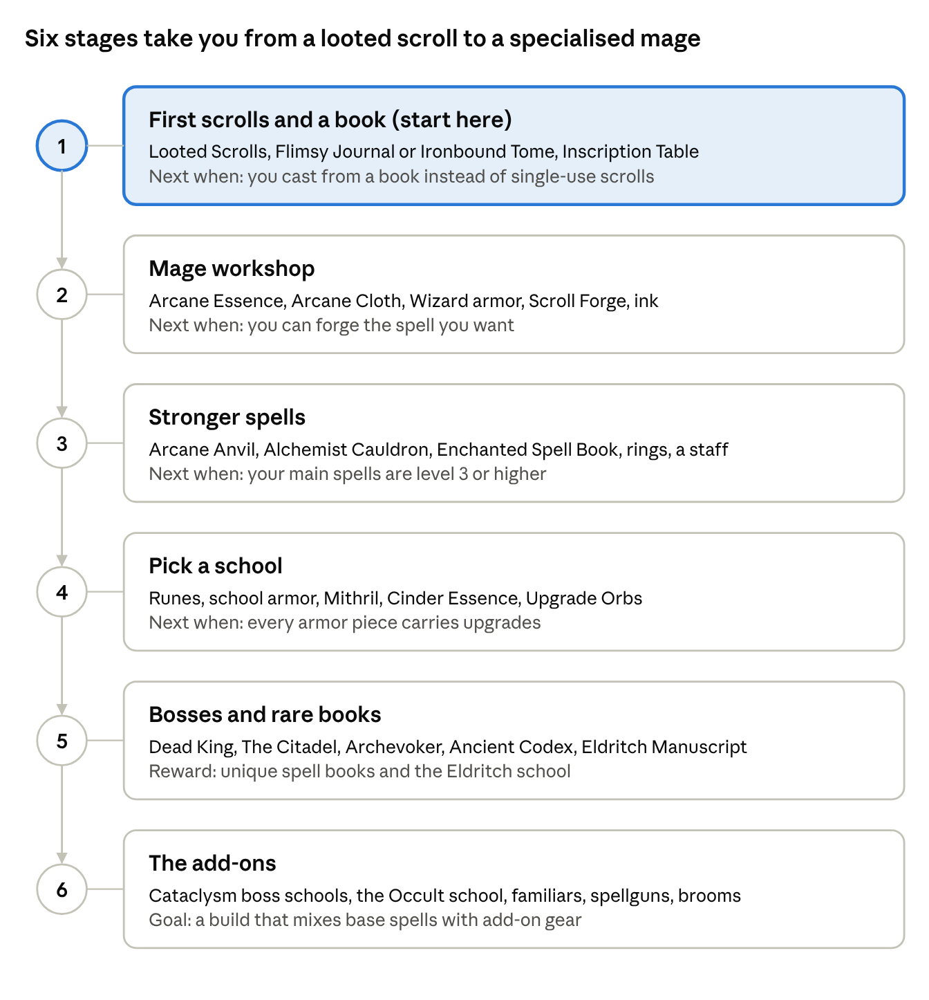

# Iron's Spells 'n Spellbooks Beginner's Guide

Iron's Spells is RPG spellcasting: find or forge spell scrolls, bind them into a spell book, and spend mana to cast. ByteNip runs Iron's Spells 3.16.3 with four add-ons; names, recipes and spell lists below were read from those jars.

Last updated Nov 12, 2026 · ByteNip 1.3.1

## The basics

A spell starts as a scroll. Cast it once and it is gone, or bind it into a spell book and cast it for as long as you have mana.

**Six things to know first**

- **Scrolls.** Every spell exists as a [Scroll](#materials). Right-click one to cast it once. Scrolls come from loot at first and the [Scroll Forge](#workstations) later.
- **Spell books.** A [spell book](#spell-books) sits in its own Curios slot and holds several spells. The [Inscription Table](#workstations) moves scrolls into it.
- **Mana.** Casting from a book spends mana, which refills by itself. Wizard armor, rings and upgrades raise your maximum and how fast it returns. Each spell also has a cooldown.
- **Schools.** Spells belong to one of nine [schools](#schools-of-magic). Gear that boosts a school only helps spells from that school, so most players pick one or two.
- **Rarity and level.** A scroll has a level, and higher levels are rarer and stronger. Two identical scrolls merge into the next level at the [Arcane Anvil](#workstations).
- **Keys.** Under Key Binds, look for Cast Selected Spell, Spell Wheel Hold and the Quick Cast slots. The spell wheel picks which book spell is active.

## Progress map

Work down the stages in order. Stages 1 to 3 make you a working mage; stage 4 onward is about getting stronger in one school.

The stage numbers match the Stage column in the tables below.

## Block and item breakdowns

The Stage column matches the progress map above. Names elsewhere in this guide link back to these tables.

### Schools of magic

Each school has a focus item, used in the Scroll Forge to choose the school and in recipes for that school's rune.

| School | Focus item | Spells (count) | Examples |
| --- | --- | --- | --- |
| Fire | Blaze Rod | 14 | Firebolt, Fireball, Wall of Fire, Burning Dash |
| Ice | Frozen Bone (strays) | 12 | Icicle, Cone of Cold, Frost Step, Blizzard |
| Lightning | Bottle o' Lightning (empty bottle on a charged creeper) | 11 | Lightning Lance, Chain Lightning, Thunder Step |
| Holy | Divine Pearl | 13 | Heal, Fortify, Angel Wings, Guiding Bolt |
| Ender | Ender Pearl | 16 | Magic Missile, Teleport, Counterspell, Recall |
| Blood | Blood Vial | 10 | Blood Slash, Ray of Siphoning, Raise Dead |
| Evocation | Emerald | 17 | Shield, Summon Vex, Summon Horse, Invisibility |
| Nature | Poisonous Potato | 13 | Root, Oakskin, Poison Arrow, Earthquake |
| Eldritch | Echo Shard | 7 | Sculk Tentacles, Sonic Boom, Telekinesis, Pocket Dimension |

### Workstations

| Block | What it does | Stage |
| --- | --- | --- |
| Inscription Table | Binds scrolls into a spell book's slots. Crafted from a book, wooden slabs and fences. | 1 |
| Scroll Forge | Makes a scroll of your choice from ink, paper and a school focus item. The ink's rarity sets how rare the scroll can be. | 2 |
| Arcane Anvil | Merges two identical scrolls into one of the next level, imbues a spell onto a weapon, and applies Upgrade Orbs to gear. | 3 |
| Alchemist Cauldron | Upgrades ink a tier (with copper, iron, gold, then amethyst), brews elixirs, and collects Blood Vials. | 3 |
| Pedestal | Displays an item. Stonecut from stone bricks. | 2 |

### Spell books

A spell book goes in its Curios slot. Better books have more spell slots and better bonuses; the tooltip shows both.

| Book | How to get it | Stage |
| --- | --- | --- |
| Flimsy Journal | Craft: copper, paper, string. | 1 |
| Ironbound Tome | Craft: chain, leather, paper. | 1 |
| Apprentice's Spell Book | Craft: gold, Hogskin, Arcane Essence. | 2 |
| Enchanted Spell Book | Craft: diamond, enchanted book, Hogskin, Arcane Cloth. | 3 |
| Ancient Codex | Craft: netherite, Ruined Book, Blood Vial, Bottle o' Lightning, Arcane Cloth. | 5 |
| Dragonskin Spell Book | Craft: Dragonskin (Ender Dragon), obsidian, Ruined Book. | 5 |
| Frostbranded Book | Craft: Ice Venom Vial, Mithril Scrap, Arcane Cloth, Ruined Book. | 5 |
| Vampiric Spell Book | Craft: Arcane Ingot, Bloody Vellum, Ruined Book. | 5 |
| Druidic Tome | Craft from a Rotten Spell Book with nature items. | 4 |
| Rotten Spell Book, Blaze Instruction Manual, Villager Bible | Found as loot. | 2 |
| Grimoire of Evokation | The illagers' unique book. | 5 |
| Necronomicon | The Dead King's unique book. | 5 |

### Materials

| Item | Where it comes from | Stage |
| --- | --- | --- |
| Scroll | Loot chests, mage mobs, or the Scroll Forge. | 1 |
| Ink (Common to Legendary) | Loot, or upgraded tier by tier in the Alchemist Cauldron. | 2 |
| Arcane Essence | Chests in most structures, trial chambers and bookshelves; dropped by mage mobs and bosses. | 2 |
| Arcane Cloth | Craft: wool + Arcane Essence. | 2 |
| Hogskin | Dropped by hoglins. | 2 |
| Arcane Ingot | Craft: an iron, copper or gold ingot surrounded by 8 Arcane Essence. | 3 |
| Cinder Essence | Dropped by Ancient Knights. | 4 |
| Mithril | Deepslate Mithril Ore. Blast Raw Mithril into scrap; 4 scrap make an ingot. | 4 |
| Blood Vial | Collected with a cauldron (see its in-game description). | 4 |
| Ruined Book | Found in ancient cities. | 5 |
| Ancient Knowledge Fragment | Ancient city, end city and library chests; Catacombs and Citadel loot. | 5 |

### Upgrades and runes

| Item | What it does | Stage |
| --- | --- | --- |
| Rune (one per school, plus Arcane, Cooldown, Protection) | Craft from a Blank Runestone and the school's focus item. Used for school armor and Upgrade Orbs. | 4 |
| Empty Upgrade Orb | Craft: Arcane Ingots, Cinder Essence and Mithril. | 4 |
| Upgrade Orb (school, Mana, Cooldown, Protection) | Empty orb + rune. Apply at the Arcane Anvil for a permanent bonus on armor, spell books and trinkets. | 4 |
| Shriving Stone | Use in a vanilla anvil to remove an imbued spell or upgrades. | 4 |
| Eldritch Manuscript | Craft: 8 Ancient Knowledge Fragments around an Echo Shard. Use it to learn an Eldritch spell. | 5 |
| Lesser Spell Slot Improvement | Adds a spell slot to a spell book, up to a limit. | 5 |

### Armor and trinkets

| Item | What it does | Stage |
| --- | --- | --- |
| Wizard armor | Craft from Arcane Cloth. Adds mana. The base for every school set. | 2 |
| School armor (Pyromancer, Cryomancer, Electromancer, Priest, Shadow-Walker, Cultist, Archevoker, Plagued) | Wizard armor + that school's rune + Arcane Essence. Adds that school's spell power. | 4 |
| Netherite Battlemage armor | Wizard armor upgraded at a Smithing Table with netherite. More protection. | 5 |
| Rings and amulets | Ring of Mana, Ring of Recovery, Affinity Rings, Amulet of Concentration and others, worn in Curios slots. | 3 |
| Staffs | Graybeard Staff, Ice Staff, Blood Staff and others add spell power and can be imbued. | 3 |

### Structures and bosses

| Structure | What is there | How to find it |
| --- | --- | --- |
| Evoker Fort | The Archevoker and the Grimoire of Evokation. | Furled Map or exploring. |
| Pyromancer Tower | A Pyromancer and fire loot. | Exploring. |
| Mountain Tower | A mage tower with scroll loot. | Exploring. |
| Mangrove Hut | The Apothecarist and potion loot. | Exploring. |
| Ice Spider Den | Ice Spiders, Ice Venom and frost loot. | Furled Map or exploring. |
| Ancient Battleground | Nether. Ancient Knights, which drop Cinder Essence. | Exploring near bastions. |
| Catacombs | The Dead King boss. Bone Keys open its vaults. | Wayward Compass. |
| The Citadel | The Echo of Tyros boss. Decrepit Keys open its vaults. | Antiquated Compass. |

### The add-ons

| Add-on | What it adds | Where to start |
| --- | --- | --- |
| Cataclysm: Spellbooks 1.1.15 | Three new schools (Abyssal, Sand, Technomancy), 69 spells and armor sets built from L\_Ender's Cataclysm boss drops. | Beat a Cataclysm boss, then look up its drops in JEI. |
| Apprentice's Codex 1.0.1 | 94 utility and combat spells, spellguns, flying brooms, the Apprentice Desk and Atelier Station. | Craft the Apprentice Desk. |
| Discerning the Eldritch 1.4.5 | The Occult school, 22 spells, cultist structures and mobs, Eldritch and Occult runes and upgrade orbs, and unique weapons. | Find a cultist base; needs Eldritch access first. |
| Alshanex's Familiars 5.0 | Thirteen tameable mage familiars, 7 spells, pet beds, a Familiar House and Origin Island rituals. | Read the Familiar Guide item. |

## Getting started builds

Each build adds to the last. Tick steps off as you go.

**Build 1: First spells**

- [ ] Loot [Scrolls](#materials) from dungeon, mineshaft and village chests. Try a few by right-clicking them.
- [ ] Craft a [Flimsy Journal](#spell-books) (copper, paper, string) or an [Ironbound Tome](#spell-books) (chain, leather, paper).
- [ ] Craft an [Inscription Table](#workstations) and bind your best scrolls into the book.
- [ ] Put the book in its Curios slot, then set the cast and spell wheel keys under Key Binds.

**Build 2: Mage workshop**

- [ ] Collect [Arcane Essence](#materials) from structure chests and mage mobs.
- [ ] Craft [Arcane Cloth](#materials) from wool and essence, then a set of [Wizard armor](#armor-and-trinkets) for more mana.
- [ ] Build a [Scroll Forge](#workstations) from crying obsidian and polished deepslate.
- [ ] Forge the spell you want: ink + paper + the [school's focus item](#schools-of-magic).
- [ ] Upgrade to the [Apprentice's Spell Book](#spell-books) with gold, Hogskin and essence.

**Build 3: Stronger spells**

- [ ] Build an [Arcane Anvil](#workstations). Merge pairs of identical scrolls to raise their level.
- [ ] Imbue a spell onto a sword or staff at the anvil, so you can cast it without a book slot.
- [ ] Build an [Alchemist Cauldron](#workstations) and upgrade spare ink to higher tiers.
- [ ] Craft the [Enchanted Spell Book](#spell-books) and add a ring or amulet from the [trinkets](#armor-and-trinkets).

**Build 4: Pick a school**

- [ ] Choose a [school](#schools-of-magic) and craft its [rune](#upgrades-and-runes) from a Blank Runestone and the focus item.
- [ ] Turn your Wizard armor into that school's [armor set](#armor-and-trinkets).
- [ ] Mine Mithril deep underground and fight Ancient Knights in the Nether for Cinder Essence.
- [ ] Craft [Upgrade Orbs](#upgrades-and-runes) and apply them to each armor piece and your book at the Arcane Anvil.

**Build 5: Bosses, rare books and add-ons**

- [ ] Craft a Wayward Compass and follow it to the [Catacombs](#structures-and-bosses) for the Dead King and the Necronomicon.
- [ ] Gather 8 Ancient Knowledge Fragments and an Echo Shard for an [Eldritch Manuscript](#upgrades-and-runes) to learn an Eldritch spell.
- [ ] Craft the [Ancient Codex](#spell-books) or Dragonskin Spell Book.
- [ ] Branch into the [add-ons](#the-add-ons): tame a familiar, or turn Cataclysm boss drops into a new school.

You do not need every school. One strong school with good armor beats a book of mixed low-level spells.

## Iron's Spells in ByteNip

Beyond its four [add-ons](#the-add-ons), six other pack mods connect to Iron's Spells. All links between mods are in [How mods interact](how-mods-interact.md), and the bosses behind the Cataclysm schools are in [L_Ender's Cataclysm](cataclysm.md).

| Mod | What it does with Iron's Spells |
| --- | --- |
| Curios | Provides the spell book slot and the ring and necklace slots. |
| Create | Spouts and Item Drains fill and empty ink bottles, Blood Vials and elixirs, so ink handling can be automated. |
| Goety | Brews some Iron's Spells potion effects. |
| Apotheosis | Affixes and gems can roll on mage gear for extra stats. |
| L\_Ender's Cataclysm | Its boss drops are the materials for the three Cataclysm: Spellbooks schools. |
| ByteNip controller patch | With a controller, the right stick picks spells on the spell wheel, A confirms and B closes it; cast and quick cast work from controller binds. |
| Ace's Spell Utils, Iron's Lib, AzureLib, Familiarslib | Libraries the mod and its add-ons need. Nothing to craft. |

## Tips and common mistakes

- **Do not burn good scrolls.** Right-clicking a scroll uses it up. Bind keepers into a [book](#spell-books) at the Inscription Table first.
- **Book not casting?** It has to be in the spell book Curios slot, not just in your inventory.
- **Ink sets the ceiling.** Common ink only forges common scrolls. Upgrade ink in the [Alchemist Cauldron](#workstations) before forging the spell you really want.
- **Save duplicates.** Two identical scrolls of the same level are worth more merged at the [Arcane Anvil](#workstations) than sold or stored.
- **Match armor to your spells.** A Pyromancer set does nothing for ice spells. Check the school on the scroll's tooltip.
- **Eldritch is learned, not forged.** Those spells need an [Eldritch Manuscript](#upgrades-and-runes) before you can use them.
- **Changed your mind?** A [Shriving Stone](#upgrades-and-runes) in a vanilla anvil strips an imbued spell or upgrades so you can redo them.
- **Mage mobs hit hard early.** Towers and forts are guarded by casters; bring a shield and ranged attacks before raiding them for scrolls.
