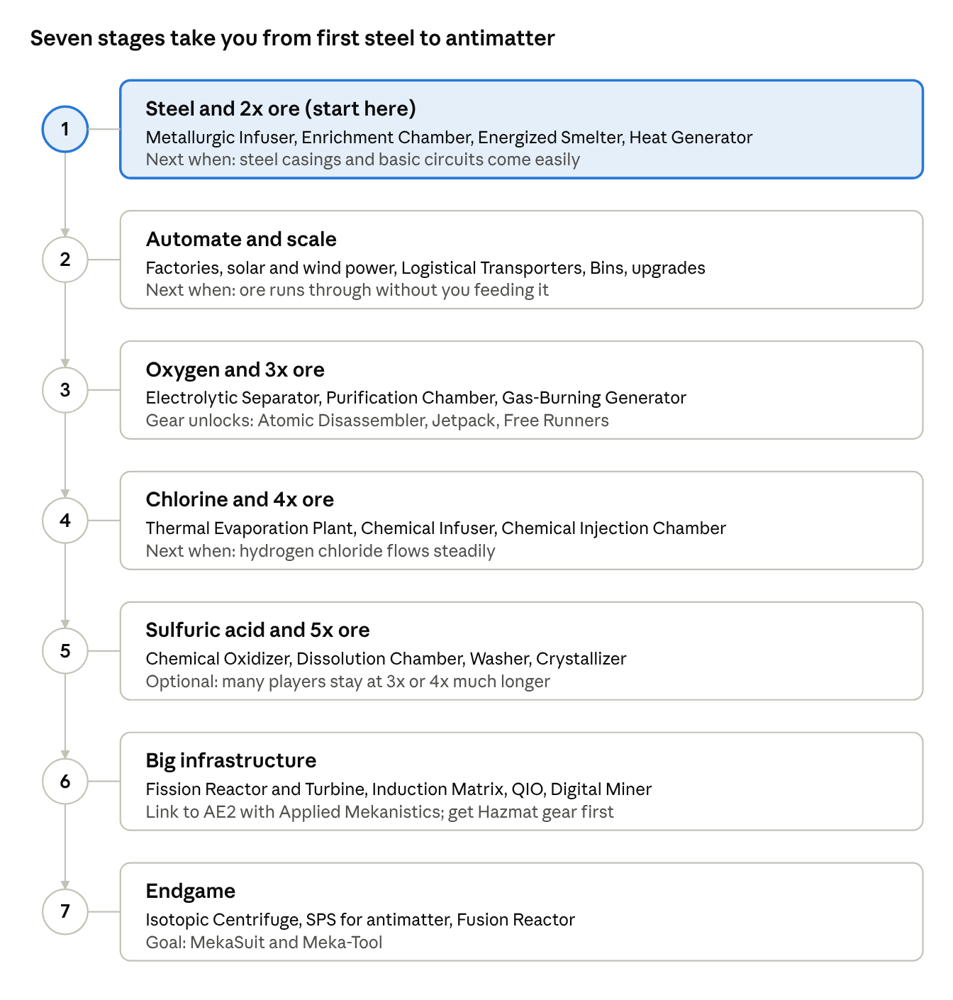

# Mekanism 1.21.1 Beginner's Guide

Last updated Nov 12, 2026 · ByteNip 1.3.1

## The basics

Mekanism is a tech mod built around one idea: process ore into more ingots, then turn that machine base into power, gear and endgame tech. On 1.21.1 it runs on NeoForge only, and the current builds are the 10.7.x line ([releases](https://github.com/mekanism/Mekanism/releases)).

Other pages: [Beginner guides](beginner-guides.md) has first steps for every other major mod, [How mods interact](how-mods-interact.md) maps the links between mods, and [Rest of the pack](rest-of-the-pack.md) lists all 129 mods. Full guides in this same format: [Applied Energistics 2](applied-energistics-2.md), [Create](create.md), [L_Ender's Cataclysm](cataclysm.md) and [Iron's Spells](irons-spells.md).

**The four jars**

| Jar | What it adds | Need it? |
| --- | --- | --- |
| Mekanism | Core machines, ore processing, pipes, QIO storage | Required |
| Mekanism: Generators | Solar, wind, gas-burning, Fission and Fusion reactors, Industrial Turbine | Strongly recommended |
| Mekanism: Tools | Paxels, armor and tools in osmium, bronze, steel, etc. | Optional |
| Mekanism: Additions | Balloons, glow panels, extra mobs and decor | Optional |

**Five concepts to learn first**

- **Energy.** Machines run on Joules in the GUI, but they accept standard Forge Energy (FE), so power from Create Crafts & Additions or Applied Flux plugs straight in.
- **Chemicals.** Gases, infusion types (carbon, redstone, diamond, refined obsidian), pigments and slurries are all one "chemical" system in 10.7. They move through Pressurized Tubes, not fluid pipes. Recipes or tooltips from older guides may still say "gas" or "infuse type".
- **Tiers.** Basic → Advanced → Elite → Ultimate. Cables, pipes, tubes, energy cubes and Factories all follow this ladder, crafted with alloys and control circuits of the matching tier.
- **Side configuration.** Every machine has a side-config tab. Each face can be set to input, output, energy or off, with colors. Get comfortable with the **Configurator** (sneak and press the Item Mode Switch key, N by default, to cycle modes) early.
- **Upgrades.** Speed, Energy, Muffling, Filter, Chemical, Anchor and Stone Generator upgrades slot into machines. Speed + Energy is the standard pair; speed alone multiplies power use.

## Progress map

Work down the stages in order; each one feeds materials or chemicals into the next. Stages 1–3 are where most beginners spend their first few sessions.

The stage numbers match the Stage column in the block tables below.

## Block breakdowns

Build the blocks roughly top to bottom in each table; the Stage column matches the progress map above. Block names in the builds and tips link back to these tables.

### Processing machines

| Block | What it does | Stage |
| --- | --- | --- |
| Metallurgic Infuser | Adds carbon, redstone, diamond or refined obsidian to items. Makes steel, alloys and enriched materials. Your first machine. | 1 |
| Enrichment Chamber | 1 ore → 2 dust. Also makes enriched carbon/redstone/diamond for the Infuser. | 1 |
| Energized Smelter | Electric furnace for dusts. | 1 |
| Crusher | Ingots → dust; plants → bio fuel. | 1 |
| Osmium Compressor | Osmium ingots + refined obsidian dust or glowstone dust → refined obsidian or refined glowstone ingots. | 3 |
| Precision Sawmill | Logs → planks with sawdust byproduct. | 2 |
| Combiner | 8 raw ore + cobblestone → 1 ore block, plus gravel and a few other blocks. A net loss for ore, so leave it out of processing. | 2 |
| Purification Chamber | Ore → 3 clumps using oxygen. Core of 3x. | 3 |
| Chemical Injection Chamber | Ore → 4 shards using hydrogen chloride. Core of 4x. | 4 |
| Chemical Dissolution Chamber | Ore → dirty slurry using sulfuric acid. Start of 5x. | 5 |
| Chemical Washer | Dirty slurry + water → clean slurry. | 5 |
| Chemical Crystallizer | Clean slurry → crystals. | 5 |

### Chemical production

| Block | What it does | Stage |
| --- | --- | --- |
| Electrolytic Separator | Water → hydrogen + oxygen. Brine → sodium + chlorine. | 3 |
| Chemical Oxidizer | Solids → chemicals, e.g. sulfur dust → sulfur dioxide. | 5 |
| Chemical Infuser | Combines two chemicals: hydrogen + chlorine → HCl; SO2 + O2 → SO3; SO3 + water vapor → sulfuric acid. | 4 |
| Rotary Condensentrator | Converts fluid ↔ chemical (water → water vapor, etc.). | 5 |
| Thermal Evaporation Plant | Multiblock that turns water into brine using heat. | 4 |

### Power

| Block | What it does | Stage |
| --- | --- | --- |
| Heat Generator | Burns fuel or sits next to lava. Good first generator. | 1 |
| Solar / Advanced Solar Generator | Free daytime power. | 2 |
| Wind Generator | More power the higher you place it. | 2 |
| Gas-Burning Generator | Burns hydrogen or ethene. Pairs with an Electrolytic Separator. | 3 |
| Energy Cubes | Tiered power storage with configurable sides. | 1–4 |
| Induction Matrix | Multiblock battery for very large storage. | 6 |
| Fission Reactor + Industrial Turbine + Boiler | Big mid–late game power; manage waste and heat carefully. | 6 |
| Fusion Reactor | Endgame power from deuterium and tritium. | 7 |

### Logistics and storage

| Block | What it does | Stage |
| --- | --- | --- |
| Universal Cable | Moves energy. | 1 |
| Mechanical Pipe | Moves fluids. | 1 |
| Pressurized Tube | Moves chemicals. | 3 |
| Logistical Transporter | Moves items with color-coded routing. Pair with a Logistical Sorter. | 2 |
| Bins / Fluid Tank / Chemical Tank | Bulk single-type storage. | 2 |
| QIO Drive Array + Dashboard | Mekanism's own item network, like a wireless ME system. | 6 |
| Quantum Entangloporter | Wireless transfer of power, items, fluids, chemicals and heat on a frequency. | 6 |
| Teleporter | Player teleportation network. | 6 |

### Endgame and gear

| Block / item | What it does | Stage |
| --- | --- | --- |
| Digital Miner | Mines a configurable radius and filters what it keeps. | 6 |
| Solar Neutron Activator + Isotopic Centrifuge | Make tritium/polonium and plutonium from fission waste. | 7 |
| Supercritical Phase Shifter (SPS) | Polonium → antimatter for ultimate crafting. | 7 |
| Atomic Disassembler | Fast multi-tool with vein mining. | 3 |
| Jetpack, Free Runners, Scuba gear | Early movement gear. | 3 |
| MekaSuit + Meka-Tool | Modular endgame armor and tool. | 7 |

## Ore yields

Mine with Fortune III, not Silk Touch: raw ore yields less per item than an ore block, but Fortune's average of 2.2 raw per ore more than makes up for it. Numbers below are ingots out, read from the recipe files in Mekanism 10.7.19.

| Tier | Ore block | Raw ore | Raw block | Fortune III (avg per ore) |
| --- | --- | --- | --- | --- |
| Furnace | 1 | 1 | 9 | 2.2 |
| 2x: Enrichment Chamber | 2 | 1.33 | 12 | 2.9 |
| 3x: Purification Chamber + oxygen | 3 | 2 | 18 | 4.4 |
| 4x: Chemical Injection Chamber + HCl | 4 | 2.67 | 24 | 5.9 |
| 5x: Chemical Dissolution Chamber + sulfuric acid | 5 | 3.33 | 30 | 7.3 |

- Raw blocks give the same yield in fewer operations and use less oxygen, HCl or acid per raw ore, so craft raw ore into blocks before it goes in.
- The [Chemical Washer](#processing-machines) uses 5 mB of water per mB of slurry, so each ore at 5x eats 5 buckets of water. Feed it from an Electric Pump on an infinite water source.
- The [Crystallizer](#processing-machines) turns 200 mB of clean slurry into 1 crystal.
- Copper drops 2–5 raw per ore, so its Fortune numbers run about 3.5 times higher than the column shows.

## Getting started builds

Each build adds one tier of ore output on top of the last, so you never tear anything down. Exact recipes shift between versions, so check JEI for each block.

**Build 1: First steel and 2x ore**

- [ ] Mine **osmium** (blue-grey ore, common underground) and plenty of iron, redstone and coal.
- [ ] Craft a **[Metallurgic Infuser](#processing-machines)**. Feed it coal or charcoal for carbon and redstone for redstone infusion.
- [ ] Make steel: iron → enriched iron → steel dust (both in the Infuser with carbon), then smelt. Make basic control circuits from osmium + redstone.
- [ ] Make **steel casings**, the base of almost every machine.
- [ ] Power: a **[Heat Generator](#power)** next to lava, or burning coal, feeding a Basic Energy Cube with [Universal Cable](#logistics-and-storage).
- [ ] Build an **[Enrichment Chamber](#processing-machines)** → **[Energized Smelter](#processing-machines)**. Set the chamber's output face to push into the smelter.

**Build 2: Automate and scale**

- [ ] Add solar or wind generators so power runs without fuel.
- [ ] Pipe ore in with a [Logistical Transporter](#logistics-and-storage) from a chest or Bin.
- [ ] Upgrade the [Enrichment Chamber](#processing-machines) into a **Factory** with a Tier Installer so it processes several ores at once.
- [ ] Add Speed + Energy upgrades.

**Build 3: 3x ore (oxygen)**

- [ ] Craft an **[Electrolytic Separator](#chemical-production)** and pump water into it (Electric Pump or a water source with a pipe).
- [ ] Send its **oxygen** output by [Pressurized Tube](#logistics-and-storage) into a **[Purification Chamber](#processing-machines)**. Vent or burn the hydrogen in a [Gas-Burning Generator](#power).
- [ ] Chain: [Purification Chamber](#processing-machines) (clumps) → [Crusher](#processing-machines) (dirty dust) → [Enrichment Chamber](#processing-machines) (dust) → Smelter.

**Build 4: 4x ore (hydrogen chloride)**

- [ ] Build a **[Thermal Evaporation Plant](#chemical-production)** to turn water into brine.
- [ ] [Electrolytic Separator](#chemical-production) #2: brine → chlorine (+ sodium).
- [ ] **[Chemical Infuser](#chemical-production)**: hydrogen + chlorine → hydrogen chloride.
- [ ] Put a **[Chemical Injection Chamber](#processing-machines)** at the front: ore → shards → [Purification Chamber](#processing-machines) → the 3x chain.

**Build 5: 5x ore (sulfuric acid)**

- [ ] Sulfur dust (gunpowder in a [Chemical Injection Chamber](#processing-machines), or coal in a Pressurized Reaction Chamber) → **[Chemical Oxidizer](#chemical-production)** → sulfur dioxide.
- [ ] [Chemical Infuser](#chemical-production): SO2 + oxygen → sulfur trioxide. Second Infuser: SO3 + water vapor ([Rotary Condensentrator](#chemical-production)) → sulfuric acid.
- [ ] Chain: **[Dissolution Chamber](#processing-machines)** (dirty slurry) → **[Chemical Washer](#processing-machines)** (clean slurry) → **[Crystallizer](#processing-machines)** (crystals) → [Injection Chamber](#processing-machines) → the 4x chain.

You don't need to rush 5x. Most players run 3x for a long time; jump when ore supply, not machine count, becomes the bottleneck.

## Mod interactions

The key addon is **Applied Mekanistics**, the official bridge between Mekanism and AE2; without it, AE2 can move Mekanism items and fluids but not chemicals. On 1.21.1 it is NeoForge only ([Applied Mekanistics](https://www.curseforge.com/minecraft/mc-mods/applied-mekanistics)).

**What Applied Mekanistics adds**

- Chemical support in normal AE2 parts: import/export buses on chemical tanks, storage buses on tanks, interfaces feeding [Pressurized Tube](#logistics-and-storage)s, and chemicals in crafting patterns.
- **Chemical storage cells** (1k to 256k). Housings use osmium instead of iron. They can't hold radioactive chemicals; for nuclear waste use the MEGA Cells radioactive cell or Mekanism tanks.
- **Chemical P2P tunnels**: right-click a P2P tunnel with a chemical tank to convert it.
- **Storage bus on a QIO Dashboard** lets your ME network see a QIO network's items.

**AE2 + Mekanism setup tips**

- Use a **Pattern Provider** pointed at a Mekanism machine to autocraft steel, alloys, circuits and processed dusts. For machines that need a chemical input, Applied Mekanistics lets the provider push that too.
- Set the machine's output face to push into an ME Interface, or put an import bus on it.
- MEGA Cells, which ByteNip includes, adds chemical cells from 1M to 256M.

**QIO vs ME**

|  | QIO (Mekanism) | ME (AE2) |
| --- | --- | --- |
| Channels | None, no cable limits | 8/32 per cable, needs planning |
| Autocrafting | No | Yes |
| Fluids and chemicals | Items only | Yes, with Applied Mekanistics |
| Wireless | Frequency-based, very easy | Wireless terminals |
| Best for | Simple bulk storage | Automation and crafting |

Many players use both: QIO for raw bulk, ME for crafting, joined by a storage bus on the QIO Dashboard.

**Other mods**

- **Power:** Mekanism accepts and outputs Forge Energy, so Create Crafts & Additions and Applied Flux connect directly.
- **Ores:** processing works on anything with the right common ore tags. How well other mods' metals go through it depends on your pack's tags and unification.
- **Recipe viewers:** JEI is close to essential; Mekanism shows all its machine and chemical recipes there.

## Mekanism in ByteNip

ByteNip 1.3.1 runs all four Mekanism jars at 10.7.19 on NeoForge 21.1.265, and nine other mods in the pack plug straight into it. This table covers only what is installed.

| Mod (version) | What it does with Mekanism |
| --- | --- |
| Applied Mekanistics 1.6.3 | Chemicals on the ME network: 1k–256k chemical cells, portable chemical cells, Chemical P2P tunnels, buses and interfaces on tanks and machines. A storage bus on a QIO Dashboard shows QIO items in ME. |
| MEGA Cells 4.11.0 | 1M–256M chemical cells, plus the MEGA Radioactive Chemical Storage Cell, the only ME cell that takes radioactive chemicals such as nuclear waste. Also adds Sky Osmium ingots. |
| Applied Flux 2.1.5 | Stores FE in ME cells and moves it through the network, so one ME system can power your Mekanism machines. |
| Create Crafts & Additions 1.6.0 | The Alternator turns Create rotation into FE for Mekanism; the Electric Motor turns FE back into rotation. |
| Cable Facades 2.1.4 + bytenip\_facades 1.0.0 | Place AE2 facades on Universal Cables, pipes, tubes and transporters to hide them in walls. Breaking the cover returns the AE2 facade; an AE2 quartz wrench also removes it. |
| Integrated Dynamics + Tunnels | Read machine and tank levels, and move items, fluids and FE between Mekanism blocks. Chemicals are not supported; use Pressurized Tubes or AE2. |
| CC: Tweaked + Advanced Peripherals | Mekanism machines and multiblocks work as computer peripherals, so a script can watch a fission reactor's temperature and waste and shut it down. |
| Mystical Agriculture 8.0.29 | Seeds for osmium, tin, lead, uranium, fluorite, steel, bronze, refined obsidian and refined glowstone. |
| Occultism 1.224.6 | Dimensional miner spirits bring back osmium, tin, lead, uranium and fluorite ores. |

**Built-in recipes for pack mods** (Mekanism ships these; check JEI for the rest)

- **AE2:** the [Crusher](#processing-machines) turns any sand into AE2 silicon, plus certus quartz, fluix, sky stone and ender pearls into their dusts. The [Enrichment Chamber](#processing-machines) turns 1 certus quartz dust into 2 silicon.
- **Farmer's Delight:** the Precision Sawmill cuts raw and cooked chicken, mutton and pork into 2 cuts, chops or bacon each.
- **Jade** shows a machine's energy, fluids and chemicals when you look at it.

## Tips and common mistakes

- **Back up your world.** Mekanism's 1.21.1 builds have been labelled alpha, and the devs warn that updates can occasionally void machine contents ([releases](https://github.com/mekanism/Mekanism/releases)).
- **Radiation is real.** Don't break a tank or pipe holding radioactive waste or spent nuclear material, and never vent it. Keep a Geiger Counter and a Hazmat suit before you touch fission.
- **Fission can melt down.** Start a reactor at a low burn rate, watch coolant and waste, and add a redstone shutoff.
- **Check side config first.** Most "my machine isn't working" problems are a face set to the wrong input/output color.
- **Pipe tier matters.** Basic cables and tubes bottleneck Factories; upgrade them with alloys as you scale.
- **Speed upgrades eat power.** Always add Energy upgrades alongside them.
- **Don't waste hydrogen.** Burn it in a [Gas-Burning Generator](#power) or store it for later fuel.
- **Use the Configurator's wrench mode** to pick up machines without losing upgrades or contents.

## Sources

- [Mekanism releases on GitHub](https://github.com/mekanism/Mekanism/releases)
- [Mekanism 10.7.0 changelog (chemical system changes)](https://modrinth.com/mod/mekanism/version/10.7.0.55)
- [Applied Mekanistics on CurseForge](https://www.curseforge.com/minecraft/mc-mods/applied-mekanistics)
- [Mekanism 10.7.19 jar on Modrinth](https://modrinth.com/mod/mekanism): recipe files behind the Ore yields table and the built-in AE2 and Farmer's Delight recipes
- [ByteNip pack repo](https://github.com/milesobrien23/bytenip-pack): installed mods and versions

Recipes and block details beyond these pages are from general knowledge of the mod; confirm them in JEI in your pack.
